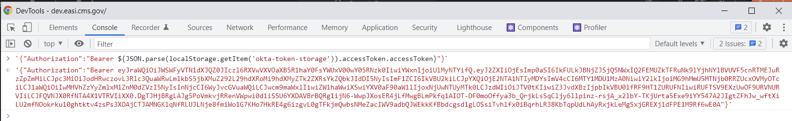
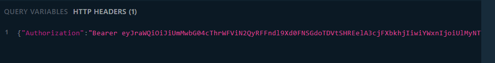

# GraphQL Playground

## Running Locally

You can visit `http://localhost:8085/api/graph/playground` to access a GraphQL playground while the Go backend is running. You will need to enter `/api/graph/query` as the query path in the UI for this to work.

### Authorization

The GraphQL endpoints require a valid `Authorization` header to use, which can be set in the "HTTP Headers" section in the lower-left of the playground. The value for this header is `"Local <JSON string>"` with quotes in the JSON string escaped. At a minimum, you'll need to set `favorLocalAuth: true` in the JSON payload, like so:

```
{ "Authorization":"Local {\"favorLocalAuth\":true}"}
```

#### Job Codes

Job codes can be included in an array for querying endpoints such as `systemIntake` that require them:

```
{ "Authorization":"Local {\"favorLocalAuth\":true, \"jobCodes\":[\"MINT_USER_NONPROD\"]}"}
```
Additional job codes beyond/instead of `MINT_USER_NONPROD` can be included in the `jobCodes` array, just make sure to escape the `"`'s around the job code names.

#### EUA ID

An EUA ID is needed for some endpoints such as creating system intakes; this can be added with the `EUAID` field:

```
{ "Authorization":"Local {\"EUAID\":\"ABCD\",\"favorLocalAuth\":true, \"jobCodes\":[\"MINT_USER_NONPROD\", \"MINT_ASSESSMENT_NONPROD\"]}"}
```


## Running in Deployed Environments

The GraphQL playground can also be used in the deployed dev/impl/prod environments. Access it with the same `/api/graph/playground` path, with the appropriate domain, i.e. `https://dev.<TODO>.cms.gov/api/graph/playground`. You'll still need to enter `/api/graph/query` in the playground UI. To authenticate, you'll need to log in to the environment, then get the Bearer token returned by Okta. The easiest way to do this is by opening the browser dev tools, then running the following command:

```
`{"Authorization":"Bearer ${JSON.parse(localStorage.getItem('okta-token-storage')).accessToken.accessToken}"}`
```

This will return a string with the authorization header you need, containing a Bearer token in the form of a long base64-encoded string:




Copy the string (_without_ the surrounding quotes). In the GraphQL playground, paste the string in the HTTP Headers section to authenticate your requests.



## Exporting operational solution help

From the repository root, with frontend dependencies installed, run:

```sh
MINT_GRAPHQL_AUTH='Local {"favorLocalAuth":true,"jobCodes":["MINT_USER_NONPROD"]}' \
  node scripts/export-solution-help.cjs http://localhost:8085/api/graph/query > solution-help.csv
```

For a deployed environment, use its HTTPS GraphQL URL and set `MINT_GRAPHQL_AUTH` to a valid `Bearer <token>` authorization header. Do not commit the token or the export. Local authorization requires a locally configured user with access to the query.

The export joins GraphQL configuration with English frontend catalog and help translations by solution key. It includes keys missing from either source and flags their presence. Arrays and structured help are JSON inside CSV cells; translation markup and links are preserved. References to `window.location.origin` remain literal. React component factories and their import locations are recorded rather than rendered, so component-specific hardcoded content and reused timelines may require consulting those components. The query does not request contacts, contractors, owners, or model usage, although help text itself may mention contacts.
